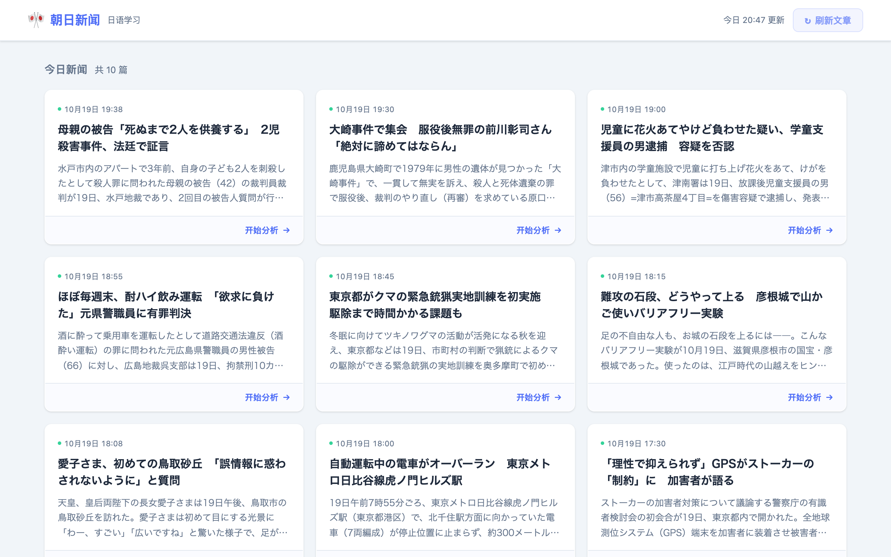

# Japanese News Reader

> 朝日新聞の最新ニュースを教材にして、AI が重要単語・N1/N2 文法をハイライトし、中国語訳を付ける日本語学習 Web アプリです。

A small web app for learning Japanese with real news. It lists today's headlines from the
Asahi Shimbun RSS feed, and for any Japanese text it uses the DeepSeek API to:

- **highlight** useful vocabulary (yellow) and JLPT N1/N2 grammar patterns (blue) in the text,
- show a **word list** with reading, part of speech, meaning and example sentence,
- give a **paragraph-by-paragraph Chinese translation**.

**Live demo:** https://japanese-news-reader.onrender.com
(free Render instance — the first visit after a quiet period takes about 30–60 seconds to wake up)



## Copyright note

The app does **not** copy or republish news articles. For each article it shows only the
headline, a link to the original page, and the short summary that the publisher itself
provides in the page's `og:description` meta tag. The learner can read the full article on
asahi.com and paste paragraphs into the analyzer (max 2,000 characters).

## Tech stack

| Part | Technology |
| --- | --- |
| Backend | Python 3, Flask |
| AI analysis | DeepSeek API (`deepseek-chat`, called via the `openai` SDK) |
| News source | Asahi Shimbun RSS + `requests` / BeautifulSoup |
| Frontend | Jinja2 templates, plain HTML/CSS/JavaScript |
| Production server | gunicorn |
| Hosting | Render |
| Tests | pytest |

## How it works

```
Browser ──GET /api/articles──▶ Flask ──▶ Asahi RSS → title / link / official summary
                                  (cached once per day in articles.json, JST date)

Browser ──POST /analyze {text}─▶ Flask ──▶ DeepSeek API (JSON mode)
                                  ◀── vocabulary / grammar / translation (JSON)
        ◀── JSON + annotated_html (Python inserts <mark> tags, HTML-escaped)
```

## Run locally

```bash
git clone https://github.com/wz20221023-hue/japanese-news-reader.git
cd japanese-news-reader
python3 -m venv .venv
source .venv/bin/activate
pip install -r requirements.txt

cp .env.example .env          # then put your DeepSeek API key in .env
python app.py                 # open http://localhost:5000
```

Run the tests:

```bash
pip install -r requirements-dev.txt
pytest
```

## Environment variables

| Name | Required | Description |
| --- | --- | --- |
| `DEEPSEEK_API_KEY` | yes | API key from https://platform.deepseek.com |
| `PORT` | set by Render | Port gunicorn binds to in production (see `Procfile`) |
| `FLASK_PORT` | no | Port for local `python app.py` (default `5000`) |

Because the site is public and every analysis uses my API credit, `/analyze` has simple
limits: max 2,000 characters per request, 10 requests per IP every 10 minutes, and a daily
cap per server process. The news list can be force-refreshed at most once every 10 minutes.

Locally, variables are read from `.env` (ignored by git). On Render, set them in
**Dashboard → your service → Environment**.

## Deploy on Render

Create a *Web Service* from this repository:

- Build command: `pip install -r requirements.txt`
- Start command: taken from `Procfile` (`gunicorn app:app ...`)
- Environment: add `DEEPSEEK_API_KEY`

## About AI-assisted development

I built this project with the help of AI coding tools. I designed
the features, tested the app with real articles, and reviewed and adjusted the code. The
AI tools helped me write and refactor the code faster.
