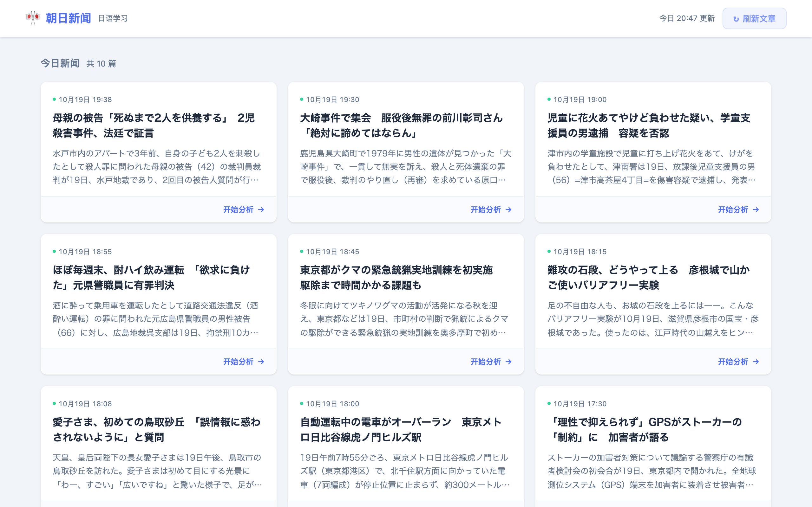

# Japanese News Reader

> 朝日新聞の最新ニュースを教材にして、AI が重要単語・N1/N2 文法をハイライトし、中国語訳を付ける日本語学習 Web アプリです。

A small web app for learning Japanese with real news. It lists today's headlines from the
Asahi Shimbun RSS feed, and for any Japanese text it uses the DeepSeek API to:

- **highlight** useful vocabulary (yellow) and JLPT N1/N2 grammar patterns (blue) in the text,
- show a **word list** with reading, part of speech, meaning and example sentence,
- give a **paragraph-by-paragraph Chinese translation**.

Long articles are split into parts of up to 2,000 characters and analyzed one part at a time.

**Live demo:** https://japanese-news-reader.onrender.com
(free Render instance — the first visit after a quiet period takes about 30–60 seconds to wake up)



## Full text and copyright

Article text belongs to The Asahi Shimbun. Opening an article shows its text as fetched
from the public article page, with a link to the original. For paid articles this is only
the free part, and the app does not try to get around the paywall. The text is kept in
memory for a few hours and never written to `articles.json`.

The owner login at `/login` (`OWNER_PASSWORD`) still exists but is no longer needed to read
the full text.

There is also a bookmarklet:

- **Bookmarklet (for anyone).** The home page has a "📖 日语分析" bookmarklet. Clicking it on an
  article page (Asahi, NHK or any Japanese site) sends the text you are reading in your own
  browser to the reader. The text travels in the URL fragment (`#…`), so the server never
  receives or stores it until you press "analyze". Select some text first to send only that
  part.

## Tech stack

| Part | Technology |
| --- | --- |
| Backend | Python 3, Flask |
| AI analysis | DeepSeek API (`deepseek-flash`, called via the `openai` SDK) |
| News source | Asahi Shimbun RSS + `requests` / BeautifulSoup |
| Frontend | Jinja2 templates, plain HTML/CSS/JavaScript |
| Production server | gunicorn |
| Hosting | Render |
| Tests | pytest |

## How it works

```
Browser ──GET /api/articles──▶ Flask ──▶ Asahi RSS → title / link / official summary
                                  (cached once per day in articles.json, JST date)

Browser ──GET /reader/<id>───▶ Flask ──▶ article page → full text (memory only)

Article page ──bookmarklet──▶ /reader#import=… (text stays in the browser)

Browser ──POST /analyze {text ≤ 2,000}─▶ Flask ──▶ DeepSeek API (JSON mode)
                                  ◀── vocabulary / grammar / translation (JSON)
        ◀── JSON + annotated_html (Python inserts <mark> tags, HTML-escaped)
```

## Run locally

```bash
git clone https://github.com/wz20221023-hue/japanese-news-reader.git
cd japanese-news-reader
python3 -m venv .venv
source .venv/bin/activate
pip install -r requirements.txt

cp .env.example .env          # then put your DeepSeek API key in .env
python app.py                 # open http://localhost:5000
```

On macOS you can also double-click `start.command`: it creates the virtual environment
on first run, starts the app (port 5000, or 5001 if 5000 is busy) and opens the browser.

Run the tests:

```bash
pip install -r requirements-dev.txt
pytest
```

## Environment variables

| Name | Required | Description |
| --- | --- | --- |
| `DEEPSEEK_API_KEY` | yes | API key from https://platform.deepseek.com (no quotes or spaces) |
| `DEEPSEEK_MODEL` | no | Model name (default `deepseek-flash`; `deepseek-chat` was retired on 2026-07-24) |
| `OWNER_PASSWORD` | no | Turns on the owner login at `/login` (not needed for full text) |
| `PORT` | set by Render | Port gunicorn binds to in production (see `Procfile`) |
| `FLASK_PORT` | no | Port for local `python app.py` (default `5000`) |

At startup the log shows whether the key is set, its last four characters and the model
name, so you can check the deployed key against the DeepSeek dashboard.

Because the site is public and every analysis uses my API credit, `/analyze` has simple
limits: max 2,000 characters per request (the reader splits longer texts), 10 requests per
IP every 10 minutes, and a daily cap per server process. Login attempts are limited too.
The news list can be force-refreshed at most once every 10 minutes.

Locally, variables are read from `.env` (ignored by git). On Render, set them in
**Dashboard → your service → Environment**.

## Deploy on Render

Create a *Web Service* from this repository:

- Build command: `pip install -r requirements.txt`
- Start command: taken from `Procfile` (`gunicorn app:app ...`)
- Environment: add `DEEPSEEK_API_KEY`

## About AI-assisted development

I built this project with the help of AI coding tools. I designed
the features, tested the app with real articles, and reviewed and adjusted the code. The
AI tools helped me write and refactor the code faster.
